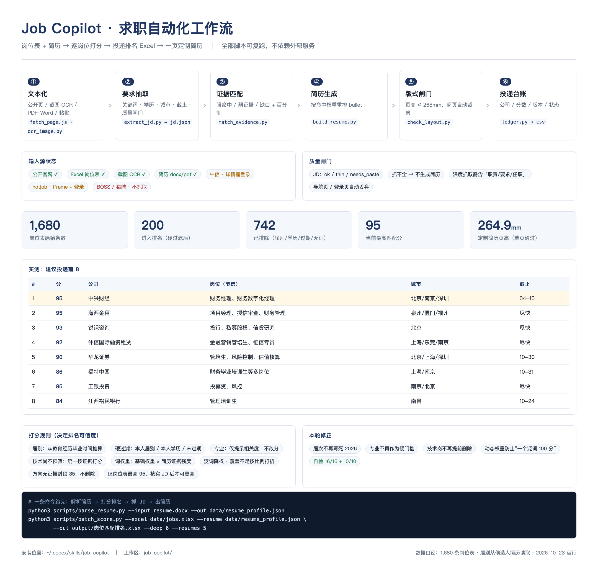

# Job Copilot

Turn a job board export and a resume into a ranked application list and one-page tailored resumes — locally, with a quality gate at every step.

**Live preview:** https://jiangxinl277-jpg.github.io/job-copilot/



> 把"一张岗位表 + 一份简历"变成"投哪些、按什么顺序投、投哪一版"。
> 全程本地运行，不依赖任何第三方 API；抓不全的内容不会被硬凑成 JD。

## What it does

| Step | Script | Output |
| --- | --- | --- |
| 1. Text intake (URL / screenshot / file / paste) | `scripts/fetch_page.js`, `scripts/ocr_image.py` | `data/raw/*.txt` |
| 2. Requirement extraction | `scripts/extract_jd.py` | `jd.json` + quality flag |
| 3. Evidence matching (hit / weak / gap) | `scripts/match_evidence.py` | `match_*.md` + score |
| 4. Tailored resume | `scripts/build_resume.py` | one-page `.docx` |
| 5. Layout gate (≤ 268 mm) | `scripts/check_layout.py` | PASS / FAIL |
| 6. Application ledger | `scripts/ledger.py` | `applications.csv` |
| Batch mode (Excel → ranking → resumes) | `scripts/parse_resume.py` + `scripts/batch_score.py` | ranked `.xlsx` + N resumes |

## Why the intake has a quality gate

Real test on two rows of a 1,680-row job table:

| Source | Captured | Verdict |
| --- | --- | --- |
| A WeChat announcement article | 95 characters (title + "分享/推荐" buttons only) | `needs_paste` → no resume generated |
| A securities firm's Zhaopin page | 3,552 bytes, including 岗位职责 / 任职要求 | passed → JD verified, scored 88/100 |

The pipeline never turns a navigation bar into a job description.

## Quickstart

```bash
git clone <your-repo-url> && cd job-copilot
python3 -m venv .venv && . .venv/bin/activate
pip install -r requirements.txt       # or: uv pip install python-docx openpyxl pillow

# demo: a 6-row sample job table + a fictional profile
python3 scripts/batch_score.py --excel examples/demo_jobs.xlsx \
        --resume data/profile.json --out examples/demo_ranking.xlsx --top 20
```

Output: `examples/demo_ranking.xlsx` with 建议投递排名 / 已排除 / 说明 sheets.

## Use your own data

1. Replace `data/profile.json` with your own structured resume (name, education, experiences with `tags`, projects, skills). Tags are how the matcher knows which bullet proves which capability.
2. Put your job table in `data/jobs.xlsx`. The reader auto-detects columns: 公司 / 岗位 / 工作地点 / 学历要求 / 届次 / 截止时间 / 投递链接 / 公告链接 / 行业分类 / 企业性质.
3. Run:

```bash
python3 scripts/parse_resume.py --input resume.docx --out data/resume_profile.json
python3 scripts/batch_score.py --excel data/jobs.xlsx --resume data/resume_profile.json \
        --out output/岗位匹配排名.xlsx --deep 6 --resumes 5
```

## Scoring rules

| Rule | Effect |
| --- | --- |
| Hard filters | 学历含本科 / 届次含 2026 / 截止未过 |
| Tiers | 金融业·银行 = A；非金融但有财务职能 = B (−15)；其余排除 |
| Keyword weights | 债券·审计·估值 = 3；数据·分析·团队 = 0.5–0.8 |
| Core-word gap | 岗位要求精算/核保/理赔而简历没有 → −12 each |
| Coverage confidence | 可匹配权重 < 8 时按比例打折，杜绝"一个词命中就 100" |
| Tech exclusion | 工程师/开发/算法岗排除；混合岗位封顶 55 |

Self-check after editing the keyword table:

```bash
python3 scripts/selftest_matcher.py     # 10 assertions, must be 10/10
```

## Screenshot OCR (macOS)

```bash
uv venv .venv --python 3.12
uv pip install --python .venv/bin/python pyobjc-framework-Vision pyobjc-framework-Quartz
python3 scripts/ocr_image.py --out data/raw shot.png
```

Runs macOS Vision offline. **Must run outside a sandbox** — sandboxed processes fail to allocate the CVPixelBuffer Vision needs.

## Site adapters

| Adapter | Site | Status |
| --- | --- | --- |
| `adapters/citic.js` | careers.citics.com | job titles only; "详情" redirects to SMS login → `needs_login` |
| `adapters/hotjob.js` | *.hotjob.cn (Beisen) | iframe job list; detail needs login → `needs_login_or_paste` |
| `scripts/fetch_page.js` | generic | `body.innerText` after render + scroll |

Login-walled platforms (BOSS, Liepin job pages) are **not** scraped; paste or export instead.

## Repo layout

```
scripts/     intake, extraction, matching, generation, layout gate, ledger, batch
adapters/    site-specific handling (iframe / click / login wall)
lib/         CDP helper + docx helpers + page-height estimator
data/        profile.json (your resume as data) · raw/ · jd_*.json · applications.csv
examples/    demo job table, sample JD, sample ranking
preview/     workflow_preview.png / .html
SKILL.md     usage when installed as a Codex skill
```

## Limits

- Job pages behind login cannot be read; scores for those rows rely on the table's own text.
- Mixed rows ("one cell, ten positions") are scored as a family, not per position — open the link before applying.
- The keyword table is rule-based; long-tail terms need additions plus the self-test.
- Layout estimation is font-metric based; always eyeball the generated `.docx` once.

## License

MIT
